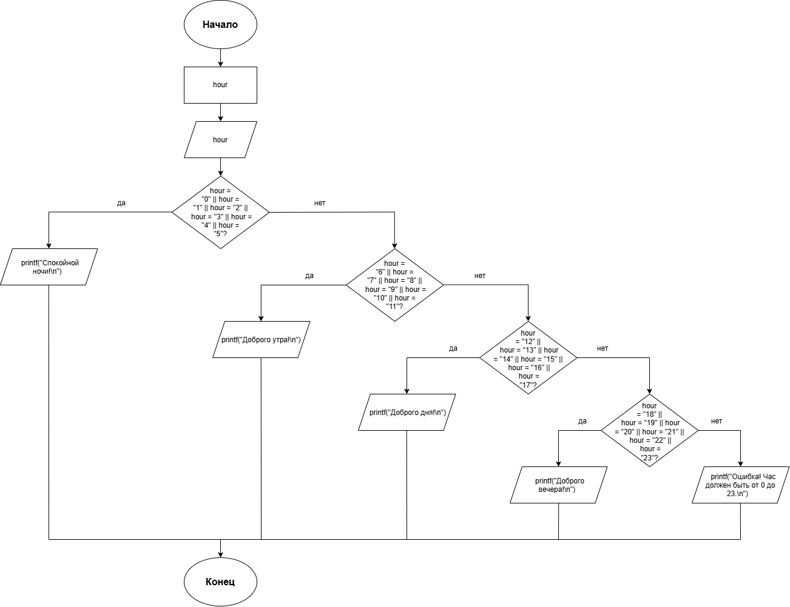

# Домашнее задание к работе 7
## Условие задачи
Записать программу, которая на ввод времени суток выводит соответствующее пожелание доброго утра, доброго дня, доброго вечера и спокойной ночи.
## 1. Алгоритм и блок-схема
### Алгоритм решения
1. Начало
2. Объявить переменные:
   - введенный час: hour
3. Ввести значение переменной:
   - ввод значения hour
4. Выбор действия по значению:
   - если hour равно 0, 1, 2, 3, 4 или 5: вывести «Спокойной ночи!»
   - если hour равно 6, 7, 8, 9, 10 или 11: вывести «Доброго утра!»
   - если hour равно 12, 13, 14, 15, 16 или 17: вывести «Доброго дня!»
   - если hour равно 18, 19, 20, 21, 22 или 23: вывести «Доброго вечера!»
   - иначе (default): вывести «Ошибка! Час должен быть от 0 до 23.»
5. Вывести результаты расчетов с подстановкой всех значений в текст
6. Конец
### Блок-схема

## 2. Реализация программы
```
#include <stdio.h>
#include <locale.h>

int goodhour()
{
    setlocale(LC_CTYPE, "RUS");
    int hour;

    printf("===== ПРИВЕТСТВИЕ ПО ВРЕМЕНИ СУТОК =====\n");
    printf("Введите час (число от 0 до 23): ");
    scanf("%d", &hour);
    printf("----------------------------------------\n");
    printf("Ваше время: %d ч.\n", hour);

    switch (hour)
    {
    case 0:
    case 1:
    case 2:
    case 3:
    case 4:
    case 5:
        printf("Спокойной ночи!\n");
        break;
    case 6:
    case 7:
    case 8:
    case 9:
    case 10:
    case 11:
        printf("Доброго утра!\n");
        break;
    case 12:
    case 13:
    case 14:
    case 15:
    case 16:
    case 17:
        printf("Доброго дня!\n");
        break;
    case 18:
    case 19:
    case 20:
    case 21:
    case 22:
    case 23:
        printf("Доброго вечера!\n");
        break;
    default:
        printf("Ошибка! Час должен быть от 0 до 23.\n");
        break;
    }
    printf("----------------------------------------\n");
}

int main()
{
    goodhour();
    getchar();
    return 0;
}
```
## 3. Результат работы программы
```
===== ПРИВЕТСТВИЕ ПО ВРЕМЕНИ СУТОК =====
Введите час (число от 0 до 23): 15
----------------------------------------
Ваше время: 15 ч.
Доброго дня!
---------------------------------------
```
## 4. Информация о разработчике
**Холодова Елизавета Юрьевна бИЦТ-262**
